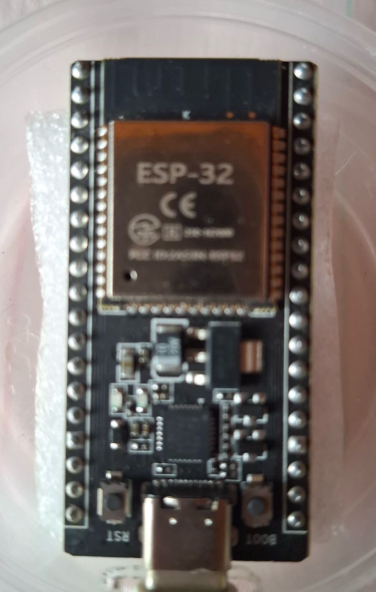

# Hardware tested: what worked, what didn't

Listings and data sheets for this class of gear (cheap ESP32 DevKits, USB
hubs, serial bridges, Bluetooth dongles) are often vague, and sometimes
simply wrong. What a part actually did on a real rig is the most reliable
information there is. This page records it, the failures included, so the
next person can buy what worked and skip what didn't.

**Please add to it.** If you've run a part listed here, confirm or contradict
its row. If you've run one that isn't listed, add it. See
[Reporting a part](#reporting-a-part). One rig's verdict on one sample is weak
evidence on its own; several rigs agreeing is useful to everyone.

How to read the verdicts:

- **Good**: in daily use on the rig, no faults traced to it.
- **Works, watch it**: works, with a known caveat in the notes.
- **Avoid**: caused a fault we traced to the part itself. The evidence is in
  [Didn't work for us](#didnt-work-for-us).
- **Retired**: removed for a reason other than a fault in the part.

[`rig-host-selection.md`](rig-host-selection.md) turns these results into
buying advice; [`rig-build.md`](rig-build.md) has the rig's history and photos.

## Parts tried on this rig

Use the USB IDs from `lsusb` to identify parts, because product names and
listings change between batches. For ESP32 boards, `esptool chip_id` gives
the chip and its revision.

| Part | USB ID | Verdict | Notes |
|---|---|---|---|
| TP-Link UB500 Bluetooth dongle (Realtek RTL8761BU) | `2357:0604` | Good | The reference rig's radio since 2026-11-16 (`HIL_BT_ADAPTER`). |
| Intel onboard Bluetooth (mimir) | `8087:07da` | Avoid for the rig | Wedged under parallel pairing. [Details](#intel-onboard-bluetooth). |
| 7-port USB 2.0 hub, self-powered, two Genesys GL850G chips | `05e3:0608` ×2 | Works, watch it | Single-TT and cascaded. One port on the second chip broke a board. [Details](#one-port-of-the-7-port-hub). |
| ESP32 DevKit with onboard CP2102 (ESP32-D0WD-V3 v3.1) | `10c4:ea60` | Avoid (one sample) | Lost serial replies under BLE load. [Details](#esp32-devkit-with-onboard-cp2102). |
| ESP32 DevKit with onboard CH340 (ESP32-D0WD-V3 v3.0) | `1a86:7523` | Good | The rig's esp32dev since 2026-11-18. 0 lost replies in the stress test that retired the CP2102 board. No USB serial number: see the notes under [Serial bridges](#serial-bridges). |
| A second DevKit with onboard CH340 (ESP32-D0WD-V3 v3.1) | `1a86:7523` | Good (stress test only) | 0 lost replies on a motherboard port, 2026-11-18. Spare. |
| External CH340 bridge, previous esp32dev | `1a86:…` (`ch341` driver) | Retired | Removed with its board 2026-11-17, not for a fault. |
| CH343 bridge on the ESP32-S3 DevKitC-1 "UART" port | `1a86:55d3` | Good | Console and flashing. The S3's native USB cable is left out (README "ESP32-S3 dual-USB-C setup"). |
| FT232R bridge (esp32c3 console) | `0403:6001` | Good | TX/RX/GND only, no reset line. The C3 is reset through its own USB. |
| ESP32-C3 native USB-Serial/JTAG (flashing, reset) | `303a:1001` | Good | Re-enumerates on every reset, which is expected. |
| A spare USB-C cable on a CP2102 board | — | Avoid (suspect) | The only adapter that logged `-71` (EPROTO) errors; the cable or its hub port was the suspect, not the chip. |
| Raspberry Pi 3B+ as host | — | Retired 2026-11-11 | One USB controller shared with Ethernet and the root disk wedged (`dwc_otg`). See `rig-host-selection.md`, "Host options". |

### Serial bridges

- A plain CH340 has **no USB serial number**, so two of them on one host get
  the same `/dev/serial/by-id/usb-1a86_USB_Serial-if00-port0` name and only
  one link survives. With more than one, address them by
  `/dev/serial/by-path/…` instead, which follows the hub port rather than
  the board. CP2102, CH343 and FT232R boards report a serial number (even if
  it's a placeholder like `0001` or `00000000`, so two of the *same* chip can
  still collide).
- Opening the port of a DevKit with the usual DTR/RTS auto-reset circuit
  resets the ESP32. Leaving DTR asserted with RTS released boots it into
  download mode (`waiting for download`), which looks like a dead board.

## Didn't work for us

Each entry says what we saw, how we narrowed it down, and how sure we are.
Most are a single sample, so a confirmation from someone else (or a
contradiction) is worth having.

### ESP32 DevKit with onboard CP2102

**Seen on this rig, 2026-11-17 and 18. One board; we have no second CP2102
DevKit to compare, so we can't yet say whether this is the board, its batch,
or the design. Confirmations either way are very welcome.**



**How to recognise it.** A black 38-pin DevKit with a USB-C socket between the
`RST` and `BOOT` buttons, a shielded module marked `ESP-32` and CE (chip
ESP32-D0WD-V3 rev 3.1), and the bridge as a small square QFN chip in the
middle of the board (USB ID `10c4:ea60`). There's no maker's name or model on
the board. Lookalikes are sold under many names, and the same layout can ship
with a CH340 instead, so check `lsusb` rather than the photo.

- **Symptom.** Under sustained BLE load (one input report every 5 ms) the
  board now and then never returned a serial reply line, and the next reply
  arrived after a 64-byte packet of `0xFF`. In CI it showed up as
  `timeout waiting for a reply line` in the `--bench` thermal and latency
  tests, and in later tests erroring one after another. The release-prep
  bench only passed on six retries.
- **What it wasn't.** The chip kept running: its uptime kept counting, it
  stayed connected and answered `PING` straight away, and the command whose
  reply was lost had run. The kernel logged no USB errors. On a different hub
  port than the one in the next entry.
- **How we narrowed it down.** Three DevKits with the same chip (ESP32-D0WD-V3),
  the same firmware, the same host and Bluetooth dongle:

  | Board | Bridge | Port | Serial-only flood | `BURST`, not connected | `BURST`, BLE-connected |
  |---|---|---|---|---|---|
  | this one | CP2102 | hub | 0 lost / 3,424 | 0 / 20 | **3 / 40 lost** |
  | DevKit B | CH340 | same hub | 0 / 3,578 | 0 / 20 | 0 / 40 |
  | DevKit C | CH340 | motherboard | 0 / 3,582 | 0 / 20 | 0 / 40 |

  Only the radio actually transmitting brings it out, and only on this
  board. That fits supply noise or droop on the board reaching the bridge,
  but we haven't measured it.
- **What we did.** Retired the board and made DevKit B the esp32dev. The
  host side was also hardened (`hil/serialdev.py` drops non-ASCII bytes and
  doesn't re-send a `BURST` whose reply was lost), so one lost line costs a
  retry rather than a run of failures, and conftest prints
  `[dut] serial path: N failed command attempts, M junk bytes dropped` when it
  happened.

### One port of the 7-port hub

**Seen on this rig, 2026-11-17.** An esp32dev on port `1-1.4.1`, which sits on
the hub's second (cascaded) GL850G chip, broke every Bluepad32 pairing with
the C3 observer (`Reason=0x3e`) for most of a day. The kernel only logged
rare `cp210x … failed to get comm status: -121` lines. Moving the cable to
another port fixed it; the other ports have been fine. The full story is the
case study in `rig-host-selection.md`. Not retested on that port since.

### Intel onboard Bluetooth

**`8087:07da`. Seen on this rig, 2026-11-16.** Under parallel pairing it wedged with
`Controller not accepting commands anymore`, which caused the phase-2 link
drops. A TP-Link UB500 dongle replaced it, and a udev rule de-authorizes the
Intel radio. It may be fine for one device at a time; it wasn't for a rig.

## Reporting a part

Open an issue or a PR against this page with:

- **What it is**: product name, the board's printed markings (a photo helps),
  and where you bought it. No affiliate links.
- **IDs**: `lsusb` vendor:product, and for ESP32 boards the chip and revision
  from `esptool chip_id`.
- **Where it was plugged in**: host, hub model, and the port path from
  `lsusb -t` (hub tiers matter, see the hub entry above).
- **What you ran and what happened**: the suite command and its verdict
  lines, with dates, and any kernel log lines (`journalctl -k`).

For a serial bridge or DevKit, the most useful single check is the bench's
thermal and latency tests, which keep the radio busy for minutes:

```sh
tester/test.sh <bundle> --bench -k "thermal or latency"
```

Look for `timeout waiting for a reply line` failures, and for the
`[dut] serial path:` line at the end of the session. Run it at least three
times; the fault above showed up roughly once in every 13 to 20 bursts.
