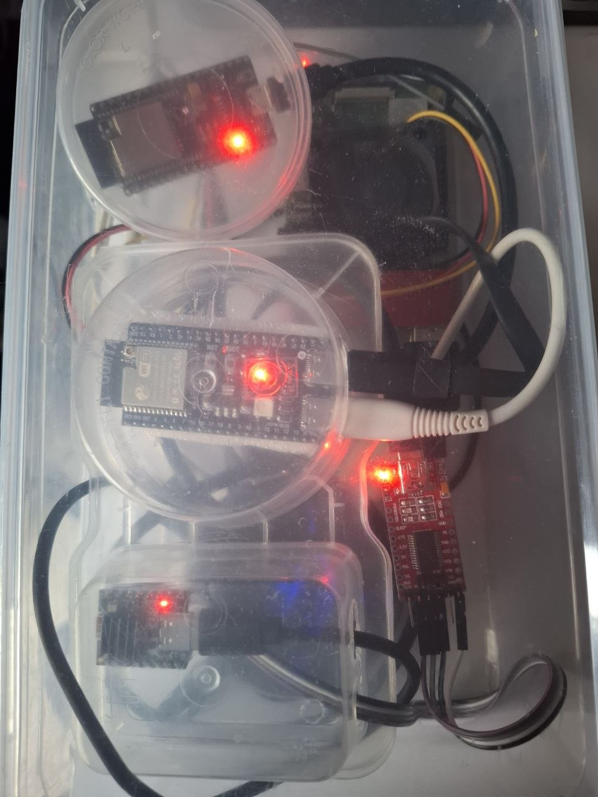

# Rig build: photos and minimum specs

What the tester rig looks like, and what it takes to run all three boards'
`--by-board` lanes concurrently. Everything here was measured on real hardware.
Wiring per LED is a separate concern: `docs/rig-hardware.md`.

The reference rig is now **mimir-u26, an up-cycled 1-litre PC** (since
2026-11-11). It replaced a **Raspberry Pi 3B+**, which ran the rig from
2026-08 to 2026-11. The Pi sections below are kept on purpose: a Pi is still a
fine way to try the project, as long as you know where its limits are.

## Choosing a tester host

The tester's work is light. It needs `esptool`, pytest, BlueZ and a Bluetooth
radio, and no firmware builds (those happen on the builder). CPU is not the
problem. **USB is.**

- **Raspberry Pi 3B+: good for one ESP32, maybe two.** Every USB port, the
  Ethernet *and* any USB storage hang off one `dwc_otg` host controller with
  one shared 5 V budget. With three boards plus their serial bridges, an ESP32
  dropping off the bus during a reset (flashing, a native-USB re-enumeration)
  produced bursts of `dwc_otg_hcd_urb_dequeue … Timed out`. More than once
  that wedged USB *and* Ethernet together, hard enough to need a power cycle:
  2026-09-11 and 2026-10-04 (see "What not to do" below). One or two boards,
  flashed through their UART bridges, on a powered hub, with root on the SD
  card, are workable.
- **Raspberry Pi 4: not tested.** Its USB ports sit on a separate controller
  (a PCIe-attached VL805), split from the Ethernet. That removes the 3B+'s
  worst coupling, so it may well manage three boards, but nobody has run this
  rig on one yet. Reports welcome.
- **An up-cycled 1-litre PC (what the rig runs on now).** An office "tiny"
  desktop from the used market gives each concern its own bus. USB is on its
  own xHCI/EHCI controllers, storage on SATA (or NVMe), networking on an
  onboard PCIe NIC. You also get plenty of RAM and x86 cores, often for less
  than a new Pi 4/5 with a PSU, case and SD card. No USB hangs have shown up
  since the move (early days: 2026-11-11 onwards). It also helped BLE: the classic
  esp32dev now connects at 8.75 ms instead of the Pi's 48.75 ms
  (`docs/bench/README.md`).

Whatever you pick: keep the ESP32 boards' USB controller free of unrelated
load (especially storage), use a powered hub for the boards, and prefer
flashing through a UART bridge over a board's native USB port where you have
the choice (README "ESP32-S3 dual-USB-C setup").

## Current reference rig: mimir-u26 (1-litre PC)

| Resource | What it has | Observed under a full run |
|---|---|---|
| Host | Lenovo 1-litre "Tiny" desktop (machine type 3238), Intel i5-3470T (2 cores / 4 threads, 2.9 GHz), Ubuntu 26.04.1, kernel 7.0 | load average ≤ 0.65 across a 3-board `--by-board` run and the `--bench` sweep, 53–57 °C |
| RAM | 8 GB (7.0 GiB usable) | ~6 GiB available; memory is a non-issue |
| Storage | 120 GB SATA SSD (root on LVM) | 10 GB used |
| Network | onboard Gigabit Ethernet (`eno1`, PCIe) plus Wi-Fi as a backup address | not on any USB bus |
| USB | boards and bridges on the xHCI controller (direct ports plus two chained powered hubs). The Bluetooth adapter is on a separate EHCI controller | no USB controller errors so far |
| BLE | onboard Intel 8087:07da (Centrino) Bluetooth, BlueZ 5.85 | 8.75 ms connection interval on all three boards |

It carries all four boards the Pi had (esp32dev, esp32c3, esp32s3 and the
observer-matrix-only esp32dev2), with the same serial adapters. Their
`/dev/serial/by-id/` names follow the adapters, so `hil_config.local.toml`
moved across unchanged. The S3 is still flashed through its CH340 bridge, with
its native USB unplugged. That's not strictly needed on this USB, but it keeps
the board from re-enumerating on every flash.

## Photos (the original Raspberry Pi 3B+ rig)

The three boards, each in its own small clear tub — keeps bare header pins
from shorting against a neighbor or the case, and makes it obvious at a
glance which enclosure holds which board when you need to unplug one. The red
UART bridge board is the ESP32-C3's (see README "ESP32-C3 serial bridge") —
it needs a second USB port beyond the board's own native USB.

*(More photos welcome — drop additional files in `docs/rig-build/` and add
them here the same way.)*

## Bill of materials (Raspberry Pi build)

What's actually in the photo above, plus the parts that make it reliable
rather than merely working:

| Part | Notes |
|---|---|
| Raspberry Pi 3B+ (or better) | the tester itself — see "Minimum specs" below for what its RAM/CPU/USB budget actually needs to cover |
| microSD card, 8GB minimum | this rig's card is 14.8GB with 4.1G (31%) actually used — 8GB is workable but tight once you add OS + repo + a few bundles/results; go bigger if you'll keep much history around |
| Official/adequate Raspberry Pi PSU | undervoltage is the classic source of Pi flakiness under USB load — don't reuse a random phone charger |
| Powered USB hub | **MCU boards plug into the hub, not the Pi's own ports** — flashing draws real current, and the Pi's onboard ports share a tight power budget with the board itself (see "USB" in the specs table below) |
| FTDI/USB-serial bridge(s) → **directly** into the Pi | unlike the MCU boards, plug the UART bridge(s) (e.g. the ESP32-C3's, see README "ESP32-C3 serial bridge") straight into the Pi rather than through the hub — it's a low-current signal path, and one fewer hop for it to glitch |
| Short, well-shielded USB cables | a long or cheap cable is the usual cause of a "board that only works if you jiggle it" — voltage drop and signal integrity both suffer over length |
| A few transparent containers (the "so it looks cool" tax) | keeps bare header pins from shorting against a neighbor or the case (see the photo above) — food-storage tubs work fine; expect your household's resident Significant Other to have opinions about which ones went missing from the kitchen |

### More blinking LEDs

For visual feedback without wiring the firmware's own activity/connection
LEDs (`docs/rig-hardware.md`), pick FTDI/USB-serial bridge boards that
already have power/TX/RX LEDs built in — most do, and it's free signal for
"is this board even talking right now." USB-C ones also make swapping boards
in and out less fiddly than micro-USB when you're juggling three of them in
a crowded hub. The red board in the photo above is one of these.

## What not to do: USB-attached storage (HDD/SSD)

This is about a Pi 3B+ (or any host whose storage, network and USB ports
share one controller). On a PC with SATA/NVMe storage it doesn't apply as
such, but the lesson does: keep anything unrelated off the boards' USB
controller.

Don't add a USB-SATA (or USB-NVMe/M.2) bridge — HDD or SSD — anywhere on
this rig, root filesystem included. It looks like a cheap capacity/speed
upgrade over just buying a bigger SD card; on a Pi 3B+ it isn't.

**Why:** every USB port *and* the onboard Ethernet ride through a single
`dwc_otg` host controller on this SoC — there's no isolation between "the
drive" and "the board bridges/hub," and they share the same 5V power
budget. Lived this on 2026-09-11: root fs was on an external USB HDD via a
USB-SATA enclosure, riding that same controller as the board hub/bridges. A
burst of `dwc_otg_hcd_urb_dequeue` timeouts during a simultaneous 3-board
BLE reconnect wedged the *entire* USB subsystem — Ethernet included — hard
enough to need a manual power cycle, not a self-recovering hang. Root fs is
back on the SD card now (see the BOM above), and that particular crash
hasn't recurred.

An SSD behind a USB-SATA bridge shares the identical failure mode — same
single controller, same shared power rail — and in practice it costs you
more capacity than it adds: instead of 3 reliable MCU lanes, you end up
babying random breakage down to 2, which erases whatever you saved by not
buying a bigger card. If you outgrow the SD card, size up the card. Anything
extra sharing the boards' one USB controller is a rig-wide single point of
failure, not just that device's own problem — the same "keep unrelated USB
load off the boards' path" reasoning behind putting the FTDI/serial bridges
straight into the Pi and the MCU boards on the powered hub, above.

## Raspberry Pi 3B+ numbers (the original reference rig)

The original reference rig, retired 2026-11-11 (see "Choosing a tester
host" above for why): **Raspberry Pi 3B+** — 4× Cortex-A53, 1GB RAM, Debian 13
(trixie), kernel 6.18. It ran all three boards via `tester/test-all.sh
--by-board` (one parallel lane per board — see that script's header comment
for why phase 1 is still serialized), though not reliably: the USB hangs
above are why it was retired. Numbers below were pulled from the live
rig, not estimated: `free`, and a `results/health-timeline-*.csv` sample
(`tester/rig-lock.sh`'s sampler — kernel thermal-zone temp, cpufreq, and the
`rpi_volt` hwmon undervoltage alarm; no `sudo`/`vcgencmd` group access
needed, see `host/hil/sysinfo.py`) from a real 3-board run.

| Resource | Observed | Verdict |
|---|---|---|
| CPU | load average peaked at 0.95 (of 4 cores) across the whole 3-board run | not the bottleneck, even with 3 concurrent phase-2 pytest+bleak+evdev processes |
| Temp / power | 42–44°C, cpufreq scaling between 700MHz (idle) and the full 1400MHz turbo; `rpi_volt`'s undervoltage alarm never fired | comfortable, no brownout under load |
| RAM | 905MiB total (1GB board, GPU split); ~150–600MiB free during/after a run; zram swap partially in use | the actual constraint — proven, but thin |
| Storage | 14.8GB SD card, 4.1G used (31%) | modest — bundles + results/logs only; PlatformIO's own build cache lives on the **builder**, not this tester |
| USB | 2 built-in hub chips already in use by the Pi's own ports, chained through 2 external hubs to reach all 3 boards | a powered USB hub is effectively required past 1–2 boards |
| BLE | one radio, shared | not a board-count ceiling — see below |

### Reading these numbers

- **1GB RAM is a genuine floor, not a comfort margin.** No OOM kills observed,
  but free memory sits at a few hundred MB under load, with swap already
  partially in use. A board with more headroom (2GB+ — a Pi 4 or Pi 5, in
  their 2GB-or-larger variants; **not** the Zero 2 W, which has only 512MB)
  would give real margin, especially before adding a 4th+ board — this rig
  hasn't been tested with more than 3.
- **CPU headroom is generous.** Even a Pi 3B+'s 4 cores are barely troubled
  running 3 boards' phase-2 in parallel. Don't over-spec for CPU here.
- **Budget USB ports per board, not per rig.** Most boards need one; the
  ESP32-C3 needs two (native + bridge — README "ESP32-C3 serial bridge"). The
  Pi's own ports run out fast once a couple of boards are wired — plan on a
  powered hub, not just the onboard ports (also keeps flashing/serial traffic
  from browning out on the Pi's own USB power budget).
- **One shared BLE radio serializes pairing, not the whole run.** `phase1`
  (flash+pair+smoke) deliberately takes the radio one board at a time
  (`tester/test-all.sh`'s `round_barrier`) — a real wall-clock cost as board
  count grows (that barrier's timeout scales with synced-board count for
  exactly this reason), not a hard ceiling on how many boards can share one
  rig.

This is what was proven on the Pi, not an exhaustively
tested minimum — if you try a smaller board (Zero-class) or push past 3
boards, the RAM ceiling is the first thing worth watching
(`free -h` / the `health-timeline-*.csv` sampler already does this for you).
